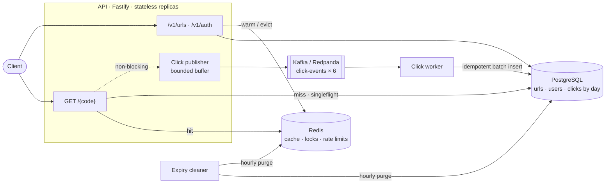

# URL Shortener

[](https://github.com/abhiv1234/url-shortener/actions/workflows/ci.yml)


A production-style URL shortener designed for **100M links and a 10:1 read/write ratio**: sub-50 ms redirects
from a Redis cache-aside layer, asynchronous click analytics through Kafka, JWT-authenticated link management,
per-IP rate limiting, and Prometheus observability, all packaged with Docker Compose and CI.

**Highlights**

- ⚡ **~27,000 req/s at p99 11 ms** on a single Node process (10:1 mixed workload, 100 connections, 0 errors).
  [Load test →](docs/load-testing.md)
- 🧊 **Cache-aside with stampede protection**: Redis singleflight lock with owner tokens and Lua
  compare-and-delete; stale reads keep redirects up when Postgres is down.
- 📈 **Exactly-once click analytics** on an at-least-once pipeline: bounded, retrying producer buffer
  (backpressure) → Kafka (6 partitions) → batch consumer → idempotent inserts into day-partitioned Postgres tables.
  Verified live against Apache Kafka 4.4: broker outages, worker restarts and full redelivery lose or duplicate nothing.
- 🛡️ **Degrades gracefully**: Redis, Postgres or Kafka can each go down without taking redirects with it, and
  integration tests prove it. [Runbook →](docs/runbook.md)
- 🔐 bcrypt + JWT auth, ownership checks, 410 for expired links, hourly purge with a Postgres advisory lock.
- 🔭 Structured JSON logs with request IDs, Prometheus metrics, alert rules, `/health` and `/ready` probes, and
  OpenAPI docs at `/docs`.
- ✅ **117 tests** (unit, HTTP, and integration against real Postgres, Redis and Kafka), **~91% line coverage**, with
  lint, typecheck and a Docker build in GitHub Actions.

## Architecture



| Path | Flow |
|------|------|
| **Redirect** | Redis `GET url:{code}` → on miss, one request per code takes the singleflight lock and loads from Postgres (followers wait on the cache) → `302` → click event enqueued in memory |
| **Create** | Validate → insert → `short_code = base62(id)` in one transaction (custom aliases → `409` on conflict) → warm cache |
| **Analytics** | API batches events to Kafka keyed by link id → worker inserts in batches with `ON CONFLICT DO NOTHING` → stats endpoint aggregates per link |

More detail: [architecture](docs/architecture.md) · [data model](docs/data-model.md) · [API](docs/api.md) ·
[runbook](docs/runbook.md) · [load testing](docs/load-testing.md)

## Tech stack

| Layer | Choice |
|-------|--------|
| API | Node.js 22/24, TypeScript (strict), Fastify 5, JSON Schema validation, OpenAPI / Swagger UI |
| Storage | PostgreSQL 16 (declarative partitioning, keyset pagination, advisory locks) |
| Cache | Redis 7 via ioredis (cache-aside, distributed locks, shared rate-limit counters) |
| Streaming | Kafka protocol via kafkajs; Redpanda for local dev |
| Auth | bcrypt, JWT (HS256) |
| Observability | pino structured logs, prom-client metrics, Prometheus alert rules |
| Quality | Vitest, ESLint (typescript-eslint), GitHub Actions, autocannon / k6 load tests |
| Packaging | Multi-stage Dockerfile (non-root), Docker Compose |

## Quick start

### Full stack in Docker

```bash
docker compose --profile app up -d --build
```

This starts Postgres, Redis, Redpanda, runs migrations, and launches the **API** (`:3000`), **click worker**
(metrics on `:9101`), **expiry cleaner** and **Prometheus** (`:9090`). Open <http://localhost:3000/docs>.

### Local development

```bash
cp .env.example .env
npm install
make up        # Postgres, Redis, Redpanda
make migrate
make run       # API with hot reload on :3000
make worker    # in another terminal: Kafka → Postgres click writer
```

### Try it

```bash
# Create an account and log in
curl -s localhost:3000/v1/auth/register -H 'content-type: application/json' \
  -d '{"email":"ada@example.com","password":"correct horse battery"}'
TOKEN=$(curl -s localhost:3000/v1/auth/login -H 'content-type: application/json' \
  -d '{"email":"ada@example.com","password":"correct horse battery"}' | jq -r .token)

# Shorten a link you own (alias and TTL are optional)
curl -s localhost:3000/v1/urls -H "authorization: Bearer $TOKEN" -H 'content-type: application/json' \
  -d '{"longUrl":"https://github.com","customAlias":"github","ttl":86400}'

# Follow it, then look at its analytics
curl -sI localhost:3000/github            # 302 Location: https://github.com
curl -s localhost:3000/v1/urls/1/stats -H "authorization: Bearer $TOKEN"
```

## API

| Method | Endpoint | Auth | Description |
|--------|----------|------|-------------|
| `POST` | `/v1/auth/register` | — | Create an account |
| `POST` | `/v1/auth/login` | — | Get a JWT |
| `POST` | `/v1/urls` | optional | Shorten `{longUrl, customAlias?, ttl?}`; owned if authenticated |
| `GET` | `/v1/urls` | required | List your links (cursor pagination) |
| `GET` | `/{code}` | — | `302` redirect · `404` unknown · `410` expired |
| `GET` | `/v1/urls/{id}/stats` | owner | Total clicks, 30-day series, top referrers |
| `DELETE` | `/v1/urls/{id}` | owner | Delete and evict from cache |
| `GET` | `/health` · `/ready` · `/metrics` · `/docs` | — | Probes, Prometheus, OpenAPI |

Errors are always `{"error": "...", "code": "..."}`. Full reference: [docs/api.md](docs/api.md).

## Design decisions

| Decision | Why |
|----------|-----|
| **Auto-increment + Base62** codes | No collisions between generated codes, short (7 chars ≈ 3.5T links), one indexed lookup. Collisions with custom aliases are detected and retried. |
| **302, not 301** | Every click reaches the service, so analytics stay accurate and links can expire. `Cache-Control: no-store` by default; configurable for CDN offload. |
| **Cache-aside, TTL = min(24h, time to expiry)** | Hot links are served from memory; expired links can never outlive their TTL in cache. |
| **Singleflight in Redis** (not in-process) | Coalesces misses across *all* replicas; lock tokens prevent a slow leader from releasing someone else's lock. |
| **Fire-and-forget click events with a bounded, retrying buffer** | Redirect latency never depends on Kafka; short broker outages lose nothing; memory stays bounded; drops are counted rather than hidden. |
| **Idempotent consumer** (`event_id` primary key) | Kafka delivers at least once; `ON CONFLICT DO NOTHING` makes stored counts exactly once. |
| **Daily partitions for clicks** | Retention is `DROP TABLE` on old partitions instead of massive `DELETE`s; stats queries prune partitions. |
| **Readiness ≠ health** | `/ready` stays up while either Redis or Postgres can serve redirects; `/health` alerts when either is down. |

## Reliability

| Failure | Behaviour | Verified by |
|---------|-----------|-------------|
| Redis down | Redirects fall back to Postgres immediately (no retry queue); rate limiting fails open | integration test: redirect < 250 ms with Redis unreachable |
| Postgres down | Cached links keep redirecting (stale OK); worker pauses without losing events | unit test: stale cache served on DB error |
| Kafka down | Redirects unaffected; failed batches are re-buffered (up to 10k events) and retried with backoff, then delivered when the broker returns; only overflow is dropped (`click_events_dropped_total`) | unit tests + live run: broker killed mid-traffic, 101/101 clicks delivered after restart |
| Cache stampede | One DB query per code across concurrent misses | unit test: 3 concurrent misses → 1 query |
| Duplicate Kafka delivery | Ignored by `ON CONFLICT DO NOTHING` | integration tests (Postgres + live Kafka) + live run: offsets rewound, 2,006 events redelivered, 0 rows inserted |
| Worker down | Events wait in Kafka; worker catches up on restart | live run: 2,000-event backlog drained in ~1 s, lag back to 0 |
| Alias vs generated code collision | Transaction retried with a new id | integration test: forced collision on `abc` |
| Abuse / hot keys | Per-IP limits shared via Redis (100 creates/h, 1000 redirects/min, 20 auth/min) | HTTP + integration tests for `429` |
| Deploy / shutdown | `/ready` → 503, drain, flush click buffer, close pools | — |

## Observability

- **Logs:** pino JSON with `requestId` on every line (echoed as `x-request-id`); credentials redacted.
- **Metrics** (`/metrics`, worker on `:9101/metrics`): `redirect_duration_seconds`, `http_request_duration_seconds`,
  `http_requests_total{status_class}`, `cache_requests_total{result}`, `stale_cache_served_total`,
  `urls_created_total`, `click_events_published_total` / `dropped_total{reason}`, `click_publish_errors_total`, `kafka_consumer_lag`,
  `clicks_written_total`, `expired_urls_purged_total`, plus Node.js process metrics.
- **Alerts:** [`monitoring/alerts.yml`](monitoring/alerts.yml), with redirect p99 > 50 ms, 5xx > 1%, cache hit < 80%,
  Redis errors, stale serving, dropped clicks and consumer lag, each linked to a [runbook](docs/runbook.md) section.

## Testing

```bash
npm test                  # 105 unit + HTTP tests, no infrastructure needed
npm run test:integration  # 12 end-to-end tests against real Postgres + Redis (+ Kafka with INTEGRATION_KAFKA=1)
npm run check             # lint + typecheck + unit tests
npm run test:coverage     # ~86% lines from unit tests alone, ~91% with all suites
npm run load-test         # 10:1 mixed load; fails if p99 > 50 ms (run server with RATE_LIMIT_ENABLED=false)
```

The HTTP tests drive the real Fastify app (`app.inject`) with in-memory services; the integration suite runs the
full stack against real Postgres and Redis, including a forced code collision, TTL expiry, ownership rules,
idempotent click writes landing in the right partition, Redis-backed rate limits and a Redis outage; a separate
suite pushes clicks through a real Kafka broker into Postgres (with a duplicate and a malformed message).
CI runs everything on Node 22 and 24 with Postgres, Redis and Kafka service containers, then builds the Docker image.

## Project structure

```
src/
├── app.ts                 # Fastify app: error handling, metrics hooks, rate limits, OpenAPI, routes
├── container.ts           # Wires Postgres, Redis and Kafka into services
├── index.ts               # API entrypoint with graceful shutdown
├── config.ts              # Typed env config; refuses weak secrets in production
├── routes/                # Thin HTTP handlers + JSON schemas (redirect, urls, auth, health)
├── services/              # Business logic: urlService, authService, statsService
├── cache/                 # Redis client, cache-aside store, singleflight lock
├── analytics/             # Click events, buffered Kafka publisher, Kafka setup
├── auth/                  # bcrypt, JWT, auth hooks
├── db/                    # Pool, migrations, daily partition management
├── jobs/                  # Expired-link purge
├── workers/               # clickConsumer.ts, expiredUrlCleaner.ts, batch click writer
└── observability/         # Metrics registry, logger config, worker metrics server
tests/                     # Unit + HTTP tests; tests/integration for real-infrastructure tests
docs/                      # Architecture, data model, API, runbook, load testing
monitoring/                # Prometheus scrape config + alert rules
scripts/                   # Load tests (autocannon, k6), build helpers
```

## Configuration

All settings are environment variables. See [`.env.example`](.env.example) for the full list with defaults.
The essentials are `DATABASE_URL`, `REDIS_URL`, `KAFKA_BROKERS`, `SHORT_URL_BASE`, `JWT_SECRET` and
`IP_HASH_SALT` (the last two must be random and 32+ characters in production), `TRUST_PROXY` (enable behind a
load balancer), and the `RATE_LIMIT_*` limits.

## Roadmap

Custom domains · QR codes · A/B redirect targets · geo routing · daily stats rollups · non-enumerable private
codes · API keys and refresh tokens · Kubernetes manifests and a Grafana dashboard.

## How this was built

The project was delivered in five incremental phases (core API → cache → analytics → auth & lifecycle →
hardening), each with its own spec and acceptance criteria in [`agents/`](agents/); see [AGENTS.md](AGENTS.md).

## License

[MIT](LICENSE)
