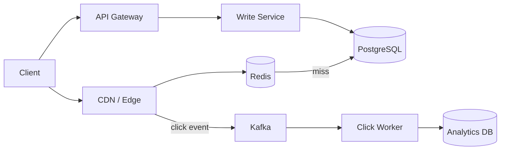

# Architecture

## High-Level Diagram



## Read Path (Hot)

1. Request hits CDN/edge with short code in path.
2. Edge checks local cache (optional).
3. On miss → Redis `GET url:{code}`.
4. On Redis miss → Postgres lookup by `short_code` (indexed).
5. Populate Redis with TTL; return 302 redirect.
6. Fire async click event to Kafka (non-blocking).

## Write Path

1. `POST /v1/urls` validates `longUrl`, optional `customAlias`, optional `ttl`.
2. If `customAlias` provided → check uniqueness; 409 on conflict.
3. Generate short code:
   - **Auto:** insert row, Base62-encode auto-increment ID.
   - **Custom:** use provided alias as `short_code`.
4. Persist to Postgres; optionally warm Redis.
5. Return `{shortUrl, id}`.

## Short Code Generation

### Option A: Auto-increment + Base62 (recommended for Phase 1)

```
id = nextval('urls_id_seq')
code = base62(id)  // e.g. 1000000 → "4c92"
```

- No collisions
- Predictable length growth
- Requires single writer or DB sequence

### Option B: Hash prefix (distributed)

```
code = base62(first_7_bytes(SHA256(longUrl + salt)))
retry on UNIQUE violation
```

## Caching Strategy

- **Pattern:** Cache-aside
- **Key:** `url:{short_code}` → JSON `{long_url, expires_at}`
- **TTL:** min(link_expires_at - now, default 24h)
- **Stampede:** singleflight on cache miss
- **DB outage:** serve stale cache for redirects only

## Redirect Semantics

| Code | Use case |
|------|----------|
| 302 | Default — allows analytics, changeable target |
| 301 | Permanent — browser caches, fewer analytics hits |

## Capacity Planning

| Resource | Estimate |
|----------|----------|
| URLs | 100M |
| Write QPS | ~400/s |
| Read QPS | ~4K/s |
| Storage | ~50 GB + indexes |
| Hot set | 20% URLs → 80% reads |

## Security

- Hash IPs in click events (`ip_hash`)
- Rate limit create + redirect per IP
- Validate URL scheme (http/https only)
- Auth required for delete and stats (Phase 4)
