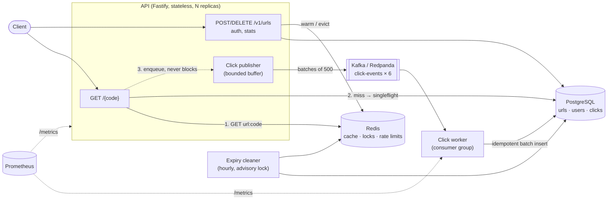

# Architecture

## Components

## Read path (hot)

1. Reject reserved or malformed codes without touching Redis or Postgres.
2. `GET url:{code}` from Redis → on hit, check `expiresAt` (410 if passed) and redirect.
3. On miss, take the singleflight lock `sf:{code}` (`SET NX EX 5`, unique token):
   - **leader** re-checks the cache, queries Postgres, writes the cache with TTL `min(24h, expires_at − now)`,
     releases the lock with a Lua compare-and-delete;
   - **followers** poll the cache every 50 ms for up to 2 s, then fall through to Postgres.
4. Respond `302` with `Cache-Control: no-store`, then enqueue a click event (in-memory, O(1)).

Failure behaviour:

| Dependency down | Effect on redirects |
|-----------------|---------------------|
| Redis | Fail fast (no offline queue) → straight to Postgres |
| Postgres | Cache hits still served; if the leader's query fails it re-reads the cache (**stale OK**) |
| Kafka | None — events buffer (10k max) and are retried; overflow is dropped with a metric |

## Write path

1. Validate: http/https only, ≤ 2048 chars, not the shortener's own host (no redirect loops), alias format, TTL.
2. **Custom alias:** single `INSERT`; unique violation → `409`.
3. **Generated code:** in one transaction, insert with a placeholder, then set `short_code = base62(id)`.
   A collision with an existing alias rolls back and retries with the next sequence value.
4. Warm the cache (best effort — a Redis failure never fails a committed write).

## Analytics pipeline

- **Producer (API):** bounded in-memory buffer, flushed every 100 ms or every 500 events; messages keyed by
  `urlId`. A failed send puts the batch back at the front of the buffer and retries with exponential backoff
  (1 s → 30 s); only events that no longer fit in the 10k buffer are dropped and counted
  (`click_events_dropped_total{reason}`). A retried batch may reach Kafka twice if just the ack was lost — the
  consumer dedupes. Flushes on shutdown with a 3 s deadline.
- **Hot keys:** keying by `urlId` puts a viral link's clicks on one partition (one consumer). A partition
  comfortably handles 100k+ of these ~200-byte events per second; beyond that, key by `urlId` + a small random
  suffix and aggregate across partitions.
- **Consumer (`src/workers/clickConsumer.ts`):** group `click-writer`, 3 partitions processed concurrently,
  manual offset resolution after each successful batch insert. A failed insert throws → the batch is retried
  (at-least-once); `ON CONFLICT DO NOTHING` on `(event_id, ts)` makes the stored result exactly-once.
- **Storage:** `clicks` range-partitioned by day; old data is dropped by detaching partitions, not `DELETE`.
- **Stats:** three aggregate queries (total, 30-day zero-filled series, top 10 referrers) on `(url_id, ts)`,
  cached for 30 s.

## Auth & authorization

- `POST /v1/auth/register|login`; bcrypt (cost 12) passwords; HS256 JWTs (1 h) with issuer check and
  `alg` pinned (rejects `none`).
- Login does a bcrypt comparison even for unknown emails, so timing does not reveal which emails exist.
- Create is public (owner recorded when a token is sent); list, delete and stats require ownership.

| Action | Rule |
|--------|------|
| Create | Public; authenticated → owned |
| Redirect | Public |
| List | Own links only |
| Delete | Owner only → 401 / 403 / 404 |
| Stats | Owner only → 401 / 403 / 404 |

## Short code generation

**Chosen: auto-increment + Base62** — no collisions between generated codes, short codes (`1,000,000` → `4C92`;
7 chars cover 3.5 trillion links), and a single indexed lookup. The trade-off is that codes are enumerable;
links that must stay private should use a custom alias or be gated elsewhere.

Alternative (not implemented): hash prefix (`base62(sha256(longUrl + salt))[:7]`), retry on collision — no
central sequence, but needs collision handling on every write.

## Redirect semantics

| Code | Use |
|------|-----|
| **302** (used) | Every click reaches the service → accurate analytics; target can change or expire |
| 301 | Browsers cache forever → fewer requests but lost analytics and no expiry |

## Capacity planning

| Resource | Estimate |
|----------|----------|
| Links | 100M |
| Writes | ~400/s |
| Reads | ~4,000/s (10:1) |
| `urls` storage | ~500 B/row → ~50 GB + indexes |
| Hot set | 20% of links → 80% of reads → size Redis for ~20M keys (~4–5 GB) |
| Clicks | 4K/s ≈ 350M rows/day → daily partitions, retention by partition drop, rollups for long-range stats |

One API process sustained ~27K mixed req/s locally (see [load-testing.md](load-testing.md)), so the
read target is met with headroom; horizontal scaling is stateless (all shared state is in Redis/Postgres).

## Security

- Raw IPs never leave the request: `sha256(salt:ip)` only.
- Rate limits per IP, shared across replicas via Redis: 100 creates/h, 1000 redirects/min, 20 auth/min.
- Request body limit 16 KB; JSON-schema validation on every route; `Authorization` and passwords redacted from logs.
- Production refuses to boot with default or short `JWT_SECRET` / `IP_HASH_SALT`.
- Containers run as the unprivileged `node` user.

## Future work

Custom domains, QR codes, A/B redirect targets, geo routing, daily stats rollups for long ranges,
private (non-enumerable) codes, refresh tokens / API keys.
